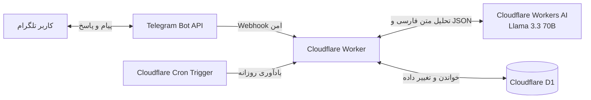

# Hermes Mini 🤖

**دستیار شخصی تلگرام برای مدیریت کارهای روزانه، با درک زبان طبیعی فارسی و زیرساخت Serverless**

Hermes Mini یک ربات تلگرامی است که کاربر می‌تواند بدون استفاده از دستورهایی مثل `/add` یا `/list` و فقط با نوشتن پیام فارسی با آن کار کند. ربات با کمک مدل زبانی، منظور پیام را تشخیص می‌دهد و یکی از عملیات مشخص‌شده را روی وظایف انجام می‌دهد.

این پروژه به‌عنوان پروژهٔ درس **رایانش ابری (Cloud Computing)** ساخته شده و روی سرویس‌های Cloudflare اجرا می‌شود؛ بنابراین برای اجرای آن نیازی به تهیه و نگهداری یک سرور شخصی نیست.

---

## فهرست مطالب

- [قابلیت‌ها](#قابلیت‌ها)
- [نمونهٔ استفاده](#نمونهٔ-استفاده)
- [معماری و روند کار](#معماری-و-روند-کار)
- [فناوری‌های استفاده‌شده](#فناوری‌های-استفاده‌شده)
- [ساختار مخزن](#ساختار-مخزن)
- [راه‌اندازی نسخهٔ شخصی](#راهاندازی-نسخهٔ-شخصی)
- [تنظیم Webhook تلگرام](#تنظیم-webhook-تلگرام)
- [مسیرهای Worker](#مسیرهای-worker)
- [ساختار دیتابیس](#ساختار-دیتابیس)
- [امنیت و مدیریت خطا](#امنیت-و-مدیریت-خطا)
- [محدودیت‌های نسخهٔ فعلی](#محدودیتهای-نسخهٔ-فعلی)

---

## قابلیت‌ها

- **ثبت وظیفه با متن آزاد فارسی:** پیام‌هایی مثل «باید گزارش آزمایشگاه رو بنویسم» به وظیفه تبدیل می‌شوند.
- **تکمیل وظیفه:** کاربر می‌تواند بگوید «گزارش رو نوشتم» یا «خریدمش» تا وظیفهٔ مرتبط تکمیل شود.
- **بازگرداندن وضعیت وظیفه:** امکان برگرداندن یک کار از حالت انجام‌شده به انجام‌نشده وجود دارد.
- **حذف وظیفه:** حذف یک وظیفه با اشارهٔ متنی یا شمارهٔ آن در فهرست.
- **نمایش فهرست کارها:** وظایف انجام‌نشده و کارهای انجام‌شدهٔ امروز نمایش داده می‌شوند.
- **گفت‌وگوی معمولی:** پیام‌هایی مثل سلام و تشکر، به‌جای ثبت وظیفه، پاسخ محاوره‌ای دریافت می‌کنند.
- **ثبت وظیفه برای فردا:** در صورتی که کاربر صراحتاً به فردا اشاره کند، وظیفه برای روز بعد ثبت می‌شود.
- **حافظهٔ کوتاه‌مدت مکالمه:** بخشی از پیام‌های اخیر برای فهم اشاره‌هایی مثل «همین رو انجام دادم» در اختیار مدل قرار می‌گیرد.
- **جلوگیری از ثبت تکراری:** اگر وظیفه‌ای با همان عنوان و تاریخ، در حالت انجام‌نشده وجود داشته باشد، دوباره ثبت نمی‌شود.
- **تأیید پیش از حذف گروهی:** درخواست حذف همهٔ کارهای انجام‌نشده مستقیماً اجرا نمی‌شود و ابتدا تأیید کاربر لازم است.
- **یادآوری روزانه:** ربات هر روز ساعت ۱۰ صبح به وقت تهران، فهرست کارهای امروز را ارسال می‌کند.

## نمونهٔ استفاده

تعامل با ربات از طریق متن معمولی انجام می‌شود؛ نیازی به حفظ کردن دستور خاصی نیست.

| پیام کاربر | رفتار مورد انتظار |
|---|---|
| `شیر بخر` | ثبت وظیفهٔ «خرید شیر» برای امروز |
| `فردا باید گزارش رو آماده کنم` | ثبت وظیفه برای فردا |
| `کارام چیه؟` | نمایش فهرست وظایف |
| `شیر رو خریدم` | تکمیل وظیفهٔ مرتبط با خرید شیر |
| `اشتباه کردم، هنوز انجامش ندادم` | بازگرداندن وظیفهٔ مرتبط به حالت انجام‌نشده |
| `مورد دوم رو حذف کن` | حذف وظیفهٔ دوم، در صورت تشخیص قطعی آن |
| `همه کارهای انجام‌نشده رو پاک کن` | درخواست تأیید؛ حذف فقط پس از تأیید صریح |
| `سلام، خوبی؟` | پاسخ محاوره‌ای بدون ثبت وظیفه |

اگر مدل نتواند وظیفهٔ موردنظر را با اطمینان تشخیص دهد، باید درخواست توضیح بیشتر کند؛ قرار نیست برای عملیات حساس، شناسهٔ یک وظیفه را حدس بزند.

## معماری و روند کار



روند پردازش یک پیام به این شکل است:

1. تلگرام پیام را به مسیر Webhook در Cloudflare Worker می‌فرستد.
2. Worker ابتدا Secret مربوط به Webhook را بررسی می‌کند و سپس شناسهٔ فرستنده را با شناسهٔ کاربر مجاز مقایسه می‌کند.
3. متن پیام، فهرست وظایف مرتبط و بخشی از تاریخچهٔ مکالمه برای مدل زبانی ارسال می‌شود.
4. مدل باید یک خروجی JSON با یکی از عملیات مجاز برگرداند.
5. Worker خروجی را استخراج و اعتبارسنجی می‌کند؛ شناسهٔ وظیفه نیز باید در فهرست شناسه‌های واقعی دیتابیس وجود داشته باشد.
6. فقط پس از اعتبارسنجی، عملیات لازم روی D1 اجرا می‌شود و پاسخ فارسی برای کاربر ارسال می‌گردد.

**نکتهٔ طراحی:** مدل زبانی مستقیماً به دیتابیس دسترسی ندارد. مدل فقط تصمیم پیشنهادی را در قالب JSON ارائه می‌کند و کد Worker مسئول اعتبارسنجی و اجرای عملیات است.

## فناوری‌های استفاده‌شده

| فناوری | کاربرد |
|---|---|
| **Cloudflare Workers** | اجرای منطق اصلی برنامه به‌صورت Serverless / FaaS |
| **Cloudflare D1** | ذخیره‌سازی رابطه‌ای وظایف، تاریخچهٔ مکالمه و شناسهٔ پیام‌های پردازش‌شده |
| **Cloudflare Workers AI** | تحلیل پیام فارسی با مدل `@cf/meta/llama-3.3-70b-instruct-fp8-fast` |
| **Telegram Bot API** | دریافت پیام‌ها از طریق Webhook و ارسال پاسخ |
| **Wrangler** | توسعه، اعمال Migration و استقرار Worker |
| **Cron Triggers** | اجرای زمان‌بندی‌شدهٔ یادآوری روزانه |
| **JavaScript** | پیاده‌سازی منطق Worker |

## ساختار مخزن

```text
.
├── migrations/
│   └── 0001_init.sql       # ساخت جدول‌ها و ایندکس‌های D1
├── src/
│   └── index.js            # منطق اصلی Worker و پردازش پیام‌ها
├── package.json            # فرمان‌ها و وابستگی‌های پروژه
├── package-lock.json       # نسخه‌های قفل‌شدهٔ وابستگی‌ها
├── wrangler.jsonc          # تنظیمات Worker، اتصال D1، AI و Cron
└── .gitignore              # فایل‌ها و اطلاعات محلیِ خارج از مخزن
```

## راه‌اندازی نسخهٔ شخصی

برای اجرای نسخهٔ خودتان به موارد زیر نیاز دارید:

- Node.js و npm
- یک حساب Cloudflare با دسترسی به Workers، D1 و Workers AI
- یک ربات تلگرام که از طریق [@BotFather](https://t.me/BotFather) ساخته شده باشد
- شناسهٔ عددی اکانت تلگرام خودتان (برای محدود کردن دسترسی)

### ۱. دریافت پروژه و نصب وابستگی‌ها

```bash
git clone https://github.com/Danesh3831/upgit.git
cd upgit
npm install
```

### ۲. ساخت دیتابیس D1

برای نسخهٔ شخصی خودتان یک دیتابیس بسازید:

```bash
npx wrangler d1 create hermes-mini-db
```

Cloudflare یک `database_id` برمی‌گرداند. مقدار آن را در فایل `wrangler.jsonc` و در بخش `d1_databases` جایگزین مقدار `database_id` موجود کنید. نام دیتابیس و مقدار `binding` را نیز مطابق تنظیمات پروژه نگه دارید:

```jsonc
"d1_databases": [
  {
    "binding": "DB",
    "database_name": "hermes-mini-db",
    "database_id": "YOUR_DATABASE_ID"
  }
]
```

**مهم:** شناسهٔ دیتابیس موجود در فایل تنظیمات این مخزن متعلق به محیط Cloudflare سازندهٔ پروژه است. برای استقرار نسخهٔ خودتان، دیتابیس مستقل بسازید و شناسهٔ خودتان را قرار دهید.

### ۳. اجرای Migration دیتابیس

```bash
npx wrangler d1 migrations apply hermes-mini-db --remote
```

این فرمان جدول‌ها و ایندکس‌های موردنیاز را در دیتابیس راه‌دور ایجاد می‌کند.

### ۴. تنظیم Secretها

سه مقدار زیر باید در محیط Worker تعریف شوند:

| نام متغیر | توضیح |
|---|---|
| `TELEGRAM_BOT_TOKEN` | توکن ربات که از BotFather دریافت می‌کنید |
| `TELEGRAM_WEBHOOK_SECRET` | رشتهٔ محرمانه برای اعتبارسنجی درخواست‌های Webhook |
| `TELEGRAM_ALLOWED_USER_ID` | شناسهٔ عددی تنها کاربر مجاز |

برای ثبت مقادیر در محیط Cloudflare، هر فرمان را اجرا کنید و مقدار را در ورودی امن آن وارد کنید:

```bash
npx wrangler secret put TELEGRAM_BOT_TOKEN
npx wrangler secret put TELEGRAM_WEBHOOK_SECRET
npx wrangler secret put TELEGRAM_ALLOWED_USER_ID
```

توکن‌ها و Secretهای واقعی را داخل کد، `wrangler.jsonc` یا مخزن Git قرار ندهید.

برای اجرای محلی می‌توانید فایل `.dev.vars` را در ریشهٔ پروژه بسازید؛ این فایل در `.gitignore` قرار دارد و نباید به Git اضافه شود:

```dotenv
TELEGRAM_BOT_TOKEN=your_bot_token
TELEGRAM_WEBHOOK_SECRET=your_webhook_secret
TELEGRAM_ALLOWED_USER_ID=your_telegram_user_id
```

### ۵. استقرار Worker

```bash
npm run deploy
```

پس از استقرار، Wrangler آدرس Worker را نمایش می‌دهد. آن را برای مرحلهٔ بعد نگه دارید.

## تنظیم Webhook تلگرام

برای دریافت پیام‌ها، باید Webhook ربات را روی آدرس عمومی Worker تنظیم کنید. در فرمان زیر، مقادیر داخل `<...>` را با اطلاعات واقعی خودتان جایگزین کنید. مقدار `secret_token` باید دقیقاً با `TELEGRAM_WEBHOOK_SECRET` که در مرحلهٔ قبل ثبت کرده‌اید یکسان باشد.

```bash
curl -X POST "https://api.telegram.org/bot<TELEGRAM_BOT_TOKEN>/setWebhook" \
  -d "url=https://hossdan.<YOUR_ACCOUNT_SUBDOMAIN>.workers.dev/telegram-webhook" \
  -d "secret_token=<TELEGRAM_WEBHOOK_SECRET>"
```

پس از تنظیم موفق Webhook، پیام‌های تلگرام به Worker ارسال می‌شوند. برای مشاهدهٔ لاگ‌های زندهٔ Worker نیز می‌توانید از فرمان زیر استفاده کنید:

```bash
npx wrangler tail
```

## مسیرهای Worker

| مسیر | روش | کاربرد |
|---|---|---|
| `/health` | `GET` | بررسی در دسترس بودن Worker و اتصال به D1 |
| `/telegram-webhook` | `POST` | دریافت Updateهای تلگرام؛ درخواست باید Secret معتبر داشته باشد |

برای بررسی سلامت سرویس، آدرس زیر را در مرورگر باز کنید:

```text
https://hossdan.<YOUR_ACCOUNT_SUBDOMAIN>.workers.dev/health
```

در حالت عادی، پاسخ JSON شامل `status: ok` و `database: ok` خواهد بود. نام Worker در تنظیمات فعلی `hossdan` است؛ اگر مقدار `name` را در `wrangler.jsonc` تغییر دهید، بخش مربوط به نام Worker در URL نیز تغییر می‌کند.

### اجرای محلی

پس از ساخت فایل `.dev.vars` و نصب وابستگی‌ها، می‌توانید Worker را در محیط توسعه اجرا کنید:

```bash
npx wrangler d1 migrations apply hermes-mini-db --local
npm run dev
```

این حالت برای توسعه و بررسی محلی است. برای دریافت مستقیم پیام از سرورهای تلگرام، Webhook باید به یک URL عمومی قابل دسترس اشاره کند؛ آدرس localhost به‌تنهایی کافی نیست.

## ساختار دیتابیس

Migration اولیه در فایل `migrations/0001_init.sql` قرار دارد و سه جدول می‌سازد:

| جدول | کاربرد |
|---|---|
| `tasks` | متن وظیفه، شناسهٔ کاربر، وضعیت، روز مربوط به وظیفه و زمان ایجاد/تکمیل |
| `conversation_history` | نگهداری محدود پیام‌های اخیر کاربر و پاسخ‌های ربات برای درک بهتر ادامهٔ مکالمه |
| `processed_updates` | ثبت شناسهٔ Updateهای تلگرام برای جلوگیری از پردازش دوبارهٔ درخواست‌های تکراری |

زمان‌های ثبت‌شده در ستون‌های زمانی به‌صورت UTC ذخیره می‌شوند؛ اما روز تقویمی وظیفه (`task_day`) با منطقهٔ زمانی `Asia/Tehran` محاسبه می‌شود. در نتیجه تعریف «امروز» در منطق برنامه به ساعت سرور وابسته نیست.

## امنیت و مدیریت خطا

- هر درخواست Webhook بدون هدر معتبر `X-Telegram-Bot-Api-Secret-Token` با پاسخ `403` رد می‌شود.
- فقط شناسهٔ ثبت‌شده در `TELEGRAM_ALLOWED_USER_ID` اجازهٔ استفاده از ربات را دارد؛ پیام کاربران دیگر بدون پاسخ نادیده گرفته می‌شود.
- پرس‌وجوهای D1 با Prepared Statement اجرا می‌شوند و عملیات وظایف با شناسهٔ کاربر نیز محدود شده‌اند.
- خروجی مدل زبانی قبل از اجرا از نظر JSON، نوع عملیات و شناسهٔ وظیفه اعتبارسنجی می‌شود.
- اگر خروجی مدل معتبر نباشد، یک بار تلاش اصلاحی انجام می‌شود؛ در صورت شکست، پیام امنی ارسال می‌شود و تغییری در وظایف ایجاد نمی‌شود.
- شناسهٔ Updateهای تلگرام در جدول `processed_updates` ذخیره می‌شود تا ارسال مجدد یک Update باعث اجرای دوبارهٔ عملیات نشود. رکوردهای قدیمی پس از بازهٔ نگهداری ۴۸ ساعته پاک‌سازی می‌شوند.
- اندازهٔ بدنهٔ درخواست Webhook محدود شده است تا ورودی بسیار بزرگ پردازش نشود.
- درخواست حذف همهٔ وظایف انجام‌نشده، پیش از دریافت تأیید صریح کاربر اجرا نمی‌شود.

## محدودیت‌های نسخهٔ فعلی

- در این نسخه فقط **یک شناسهٔ تلگرام** مجاز است؛ این پروژه در وضعیت فعلی یک دستیار شخصی تک‌کاربره است، نه یک سرویس عمومی چندکاربره.
- ورودی اصلی ربات متن است. پیام‌های غیرمتنی پشتیبانی نمی‌شوند و پاسخ راهنما دریافت می‌کنند.
- حافظهٔ مکالمه کوتاه‌مدت است و برای نگهداری دائمی یا جست‌وجوی کامل مکالمات طراحی نشده است.
- فقط امروز و فردا به‌عنوان زمان ثبت وظیفه در منطق فعلی پشتیبانی می‌شوند؛ انتخاب تاریخ دلخواه یا تکرار وظایف پیاده‌سازی نشده است.
- عنوان بخش کارهای مربوط به روزهای غیر از امروز در فهرست فعلی «عقب‌افتاده» است؛ بنابراین وظیفهٔ ثبت‌شده برای فردا نیز ممکن است در همان بخش نمایش داده شود.
- ترتیب فهرستی که به مدل برای تشخیص شناسه‌ها داده می‌شود، در همهٔ حالت‌ها الزاماً با ترتیب نمایشی فهرست برای کاربر یکسان نیست؛ ارجاع عددی در فهرست‌های ترکیبی (مثلاً دارای وظایف فردا و انجام‌شده) باید با تست بیشتری بررسی شود.
- Cron در تنظیمات فعلی روی `30 6 * * *` تنظیم شده است؛ یعنی ساعت ۰۶:۳۰ UTC که برابر با ۱۰:۰۰ صبح تهران است.
- پروژه با هدف استفاده از سرویس‌های Cloudflare و محدودیت‌های پلن رایگان طراحی شده است؛ هزینه و سهمیهٔ واقعی به میزان استفاده و شرایط حساب Cloudflare و سرویس هوش مصنوعی بستگی دارد.
- در نسخهٔ فعلی مخزن، فرمان `npm test` در `package.json` تعریف شده، اما فایل‌های تست همراه پروژه ارائه نشده‌اند.

---

## وضعیت پروژه

این مخزن نسخهٔ پیاده‌سازی‌شدهٔ پروژهٔ آموزشی **Hermes Mini** است. پیشنهادها، گزارش خطاها و مشارکت برای بهبود پروژه قابل استقبال‌اند.

**مخزن GitHub:** [Danesh3831/upgit](https://github.com/Danesh3831/upgit)
